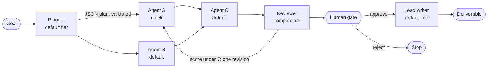

# Conductor

A multi-agent orchestrator you can watch. Give it a goal and a planner designs a team for it. Specialists run in parallel along a dependency graph and pass work to each other. A reviewer on a stronger model sends weak work back once. Then the run stops and waits for a person to approve before a lead writer produces the final answer.

Every step is visible: the graph, each agent's streamed output, the exact prompt it received, the reviewer's scores, token counts and which model answered.



## Run it

```bash
git clone https://github.com/sulmatajb/agent-conductor
cd agent-conductor
npm install
cp .env.example .env        # add your ANTHROPIC_API_KEY
npm start                   # http://127.0.0.1:4317
```

No key yet? `npm start` still serves the page with a recorded run, and `npm run dev:mock` runs the full live path against a scripted stand-in API, so you can see live mode without spending tokens.

A live run makes about ten model calls and usually finishes in two to four minutes. Expect well under a dollar per run at list prices; the page shows the exact token count as it goes. Set a spend limit on your key in the Anthropic Console anyway.

## How it works

The pipeline lives in one DOM-free module, [`public/js/orchestrator.js`](public/js/orchestrator.js). It runs unchanged in the browser and in Node tests.

| Stage | What happens | Model tier |
|---|---|---|
| Plan | The planner returns a team as JSON: roles, briefs, a tier per agent, and dependencies. | default |
| Fan out | Every agent starts the moment its inputs are done, up to three at a time. Each receives its teammates' finished work. | quick or default, chosen by the planner |
| Review | A reviewer that wrote none of the work scores each piece 1 to 10 against its brief. Anything under 7 goes back once with one note. | complex |
| Gate | The run waits on a promise only a person can resolve: Approve or Reject. | human |
| Synthesize | The lead writer merges the reviewed work and resolves disagreements. | default |

Design choices worth knowing:

- **The plan is untrusted input.** It comes from a model, so `sanitizePlan` normalizes ids, renames reserved ones, keeps only dependencies that point backwards (no cycles by construction), and caps depth at three levels.
- **Maker and checker differ.** The reviewer always runs on the complex tier, which maps to a different model than any worker.
- **Bounded self-correction.** Each agent can be sent back once. No loops that run until the model is satisfied with itself.
- **A failed agent does not sink the team.** Its dependents run with the inputs they have. Errors that make further calls pointless (auth, rate limits, budget, stop) end the run cleanly.
- **Drivers are swappable.** The orchestrator only knows `ask({ key, prompt, tier, signal, onText })`. Three drivers ship: recorded replay, the local runner, and claude.ai's in-page model access.

The prompt contracts are at the top of the orchestrator, and the page shows each one under "What just happened".

## Models

| Tier | Default model | Effort | Used by |
|---|---|---|---|
| quick | `claude-haiku-5-5` | low | listing, lookup, extraction work |
| default | `claude-sonnet-5-5` | medium | planner, judgment work, lead writer |
| complex | `claude-opus-5-5` | medium | reviewer |

Override any of them in `.env`. Sonnet and Opus calls opt into Anthropic's server-side refusal fallback.

## The local runner

[`server.mjs`](server.mjs) serves the page and streams model calls through the official Anthropic SDK. It is built to be safe to leave running on a laptop:

- Binds to `127.0.0.1` and warns loudly if you change that.
- Answers only same-origin JSON requests, so other websites cannot drive it through your browser.
- Accepts a tier, never a model name, so the page cannot pick an expensive model.
- Stops after `CONDUCTOR_MAX_CALLS` calls per process (default 300) and `CONDUCTOR_MAX_PER_MINUTE` per minute (default 40).
- Your key stays in `.env`, which git ignores, and never reaches the browser.

## Recordings

After a live run, **Save run** writes it to `recordings/` (git-ignored). Open `/?replay=recordings/<file>.json` to replay it. To make a run the page's default, copy its `goal` and `calls` into [`public/js/recording.js`](public/js/recording.js). The run shipped there is a hand-written sample until a real one replaces it.

## Other ways to host it

- **Static hosting** (GitHub Pages, any file host): publish `public/`. The page detects there is no runner and offers replay only.
- **Inside Claude**: when the page runs as a claude.ai artifact, it uses the viewer's own Claude account through `window.claude`, with no key and no server.

## Tests

```bash
npm test
```

Thirteen tests cover the scheduler (dependency order, parallelism, the concurrency cap), plan sanitizing, the revision rule, the gate, failure and cancellation, recording round trips, and a full run through the real runner and SDK against a mock API, including model routing, fallbacks, and the runner's guards.

## Layout

```
server.mjs                 local runner: static files, /api/ask (SSE), /api/recordings
public/index.html          the page
public/js/orchestrator.js  the pipeline, prompts, plan sanitizing (no DOM)
public/js/drivers.js       replay, local runner, claude.ai
public/js/app.js           graph, inspector, telemetry, gate UI
public/js/recording.js     the default recorded run and preset goals
scripts/mock-anthropic.mjs scripted stand-in API for tests and npm run dev:mock
test/                      node:test suites
```

## License

MIT. Built by [Besnik Sulmataj](https://besniksulmataj.com).
